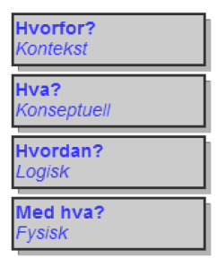
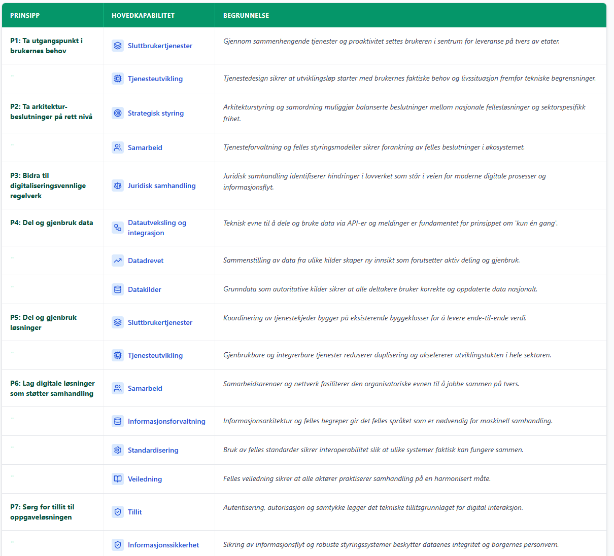
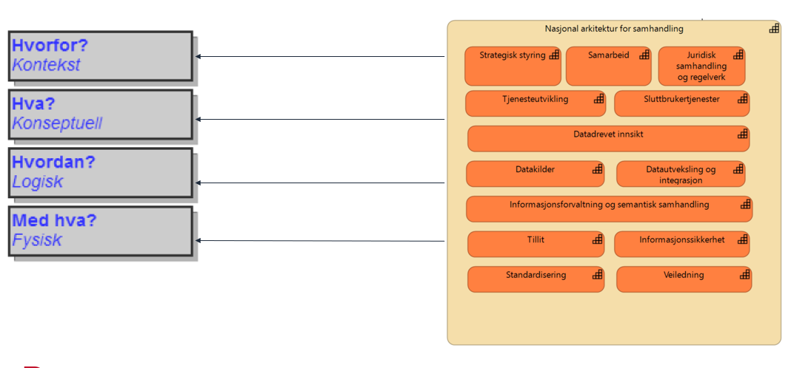
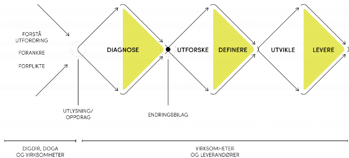

> **Source:** SAMT-BU core team / Digdir, February 2026.
> [Open in Word Online](https://view.officeapps.live.com/op/view.aspx?src=https%3A%2F%2Fraw.githubusercontent.com%2FSAMT-X%2Fsamt-bu-files%2Fmain%2Fcontributions%2Fdigdir-drafts%2FMal%20for%20arkitekturvurderinger.docx&ui=en-US&rs=en-US) – [download Word file](https://github.com/SAMT-X/samt-bu-files/raw/main/contributions/digdir-drafts/Mal%20for%20arkitekturvurderinger.docx) (in Norwegian)

## Template for architecture assessments – draft

**NB!** In general about using the template: You do not need to use EVERYTHING in the template; use it as a starting point and pick out what is most relevant. The most important thing is to be deliberate about what you choose to describe. The description will evolve throughout the development process.

## Draft template – overall structure

**Contextual – Why** – Sets the frame for the architecture. Helps to delimit and describe the context. Describes the background and starting point, such as goals and drivers, important principles (IT principles), strategies, guidelines and preconditions. Vision and scope of what is to be built..

**Conceptual – What** – Defines what is to be built. This describes the properties of the solutions, i.e. which requirements apply. Requirements and objectives are elaborated and detailed. All parts of the goals and scope are covered without describing the implementation. Requirements and properties are described, among other things, in terms of which services are needed.

**Logical – How** – Describes the logical structure. This describes how the requirements and properties are met. This is done by grouping the services into logical components. The «ideal» solution is explored without implementation being part of the assessment. Several alternative solutions are assessed to test different priorities and the consequences of the alternative proposals.

**Physical – With what** – Description of how the planned structure is intended to be implemented. This describes the physical solutions, i.e. which concrete (physical) components (systems, software), which technology (programming languages), architecture patterns, products etc. have been chosen to implement the logical components. Standards and patterns are used to help define the solution. In addition come guidelines from the runtime platforms and guidelines for development. Different solution alternatives are assessed.

### Background (why) – Contextual level

Stakeholders, goals and drivers, framework conditions, preconditions (strategies, principles and current challenges that the choice of new architecture/technology is to solve). Particularly relevant are typically the overarching architecture principles (and which capabilities are needed).

* Goals and guidelines

  * Principles and guidelines
  * Shared ecosystem

    * Overarching architecture principles for digitalisation in the public sector
    * National Architecture capabilities
  * Other guidelines for architecture choices

### Needs (what)

* The dream journey (see Miro)

Here the criteria against which the alternatives are to be assessed are defined. The criteria are divided into three types:

* Functional needs

  * Specific abilities the service must have to deliver value to the end user
* Non-functional requirements, if any

  * Performance, volume, security, …
* Overarching architecture principles for digitalisation in the public sector
* Relevant capabilities (National Architecture)

  * Identify which national capabilities are critical for this choice

### Conceptual architecture

* Define high-level alternatives independent of technology

  * Are to be linked to the relevant criteria for choosing an alternative

    * (See «Needs» above)
* Conceptual alternatives, e.g. relating to:

  * Pattern: Describe the overall architectural style (e.g. distributed vs. centralised, event-driven vs. request-response)
  * Monolith vs. microservices
  * Data-centric service development
  * Shared information models – different ways of doing this
  * Shared ecosystem, …
* Assessments of the alternatives against each other

  * Result: Conceptual IT target picture for the solution
  * Starting point for the solution choices

### Application architecture (logical and physical)

* Logical design (how): This describes a logical grouping of the needs into functional components – it should be technology-independent.
* Implementation (with what)
* Solution alternatives
* Assessment of solution alternative

  * Alternative solution choices must be described and assessed against each other

    * Criteria with a +/- method
* Recommended solution
* Pilot/POC

  * Should be based on a chosen concept
  * What do you want to get out of it?
  * Must be seen in connection with goals, needs, principles
  * Should follow the same template, but does not need to fill in all the content

- - -

**For discussion:**

* How deep into architecture governance should the document go? E.g. management costs, handover to line operations, …
* Guidelines must be included (the architecture principles ⇒ NA capabilities)
* Regarding the principles below:

  * We want each solution alternative to state «to what degree» the capabilities are needed (supported or implemented). «To what degree» is a self-assessment on «0, NA, 1 = to a small degree, 2 = to a large degree, 3 = to a very large degree»
* The principles must be linked to. The capabilities must be explained «a little more». Link to the whole capability model. Sub-capabilities must be included in the overview.
* Other architecture patterns that should be included and argued for?

  * Event-driven and service chains

**Areas that should be included in the document:**

* Business goals to be supported (taken from a separate process, if any), known needs etc.
* Architecture target picture
* Solution architecture

**NB!** Alternative assessments must be seen in light of where you are in a development process.

* For each solution alternative to be assessed, these may be at different levels of abstraction.
* The purpose of dividing an architecture description in this way is to structure the argumentation around architectural choices and decisions, making it easier to distinguish what is relevant for a given issue and why the choices that were made were made.

## Appendix A: Preliminary notes on architecture governance

### Plan for operationalising architecture governance

1. A role as responsible architect is established for each pilot.
2. A role as «chief architect» is established for the deliveries from the project, such as target architecture, patterns and architecture framework.
3. A template is established for the assessments that must be made before and during the establishment of pilots. The template is to be further developed through use in the pilots and is part of the main deliverable «framework».
4. An architecture board is established, consisting of representatives from all the organisations, which assesses the architecture choices that have been made (documented according to the template).
5. The architecture assessments are to be presented to the architecture board at the start/end of each sprint.
6. The template is placed on the project's documentation site «SAMT-BU Docs» and filled in there. The template is «dynamic» and becomes more completely filled in throughout the development process.
7. Architecture choices made in the pilots are evaluated and become part of the overall architecture deliverable from the project.

### Some details

* Roles and responsibilities (must be defined)

  * «Responsible architect» – responsible for the whole. Tactical.

    * Ensure that IT target pictures, roadmaps and solution patterns are drawn up in an appropriate way
    * Ensure that the solution architecture is in line with achieving the goals
  * Team architect/Solution architect: Operational
* Methodology…
